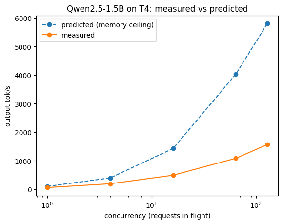

# Day 5: measured vs predicted (Qwen2.5-1.5B-Instruct, fp16, Colab T4)

Prediction (memory ceiling, KV cache included): `c × 320 ÷ (3.09 GB + c × 0.031 GB)` tok/s.
Measured: Day 4 sweep (`day4-concurrency-sweep.csv`, 512 in / 128 out; the c=16 / 20-prompt run is dropped).

| Concurrency | Measured tok/s | Predicted tok/s | % of ceiling |
|---|---|---|---|
| 1 | 62.0 | 102.5 | 60.4% |
| 4 | 194.8 | 398.3 | 48.9% |
| 16 | 493.0 | 1427.8 | 34.5% |
| 64 | 1086.6 | 4036.3 | 26.9% |
| 128 | 1567.9 | 5803.3 | 27.0% |

## Five claims

1. At c = 1 I hit 62 tok/s, 60% of the 103 tok/s memory ceiling.
2. As concurrency rises I get a smaller share of the ceiling (60% at c1 down to 27% at c64), so the gap grows.
3. From c = 64 to c = 128 the share holds at 27%, so at high concurrency memory is no longer the limit. Something else is, most likely compute or scheduling overhead.
4. The c = 1 gap is mostly real bandwidth. The T4 actually delivers about 200–250 GB/s, not the 320 on its spec sheet, and each step also pays fixed CPU and kernel-launch overhead.
5. Bigger batches fall further behind because the math per weight read grows with the batch. The T4 starts running out of compute and hits its 70 W power cap, prefill for new requests steals decode steps, and each request's KV-cache reads add up.

Takeaway: at small batches you're limited by memory, at big batches by compute (the roofline model).

Claims 4–5 are hypotheses, not yet measured.
